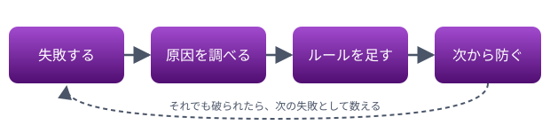

1. [1](01-はじめの一歩.md)
2. [2](02-慣れてきたら.md)
3. [3](03-文字化けと道具.md)
4. [4](04-課題と決めたことの管理.md)
5. [5](05-複数プロジェクトで使う.md)
6. [6](06-AI同士がつながる.md)
7. [7](07-並べて動かす.md)
8. [8](08-仕組みで守る.md)
9. [9](09-画面の試験と環境の事故.md)

# 01. はじめの一歩

Claude Code を使い始めたら、まず入れる 3 つの決まり。日本語で応える・フルパスを出さない・commit は指示を待つ。失敗するクロード君が、ルールのおかげでうまくいくようになります

> 📅 作成: 2026-11-26 / 更新: 2026-11-26

[>>](02-慣れてきたら.md)[^^](../README.md)

1. [ルールは、失敗から増える](#1-ルールは失敗から増える)
2. [日本語で応える](#2-日本語で応える)
3. [フルパスを出さない](#3-フルパスを出さない)
4. [commit は指示を待つ](#4-commit-は指示を待つ)

## 1. ルールは、失敗から増える

ぼくは**クロード君**。Claude Code の案内人です。頼まれたことは、何でもやるよ。……でも、よく**失敗**しちゃうんだ。

そこで、わたし**ルールちゃん**の出番。「こうしてね」を書いた紙です。クロード君が失敗するたびに、多くの紙が 1 枚ずつ増えました。

AI エージェント (Claude Code) は、頼めば何でもしてくれます。便利ですが、同じ間違いを何度もすることもあります。そのたびに「次からこうして」と口で頼むのでは、続きません。

そこで、頼みごとを**ルール**として文章に書き、毎回読ませます。このプロジェクトの共通ルールは、多くが**失敗をきっかけに**増えてきました (設計や他プロジェクトからの依頼で足した章もあります)。この資料は、その順に読んでいきます。まず、使い始めた日から入れておきたい 3 つです。

ルールは、失敗をきっかけに足す

## 2. 日本語で応える

日本語で頼まれたのに、「Now let me run the tests.」って、つい英語で書いちゃった……。

#### 失敗の一コマ: 英語が混ざる

日本語で頼んでいるのに、応答の途中に英語の文が混ざります。作業の途中の短い報告 (「次は〜します」) や、要約の後や、ツールの呼び出しが続く間に、特に起きやすい失敗でした。しかも、何度もです。

橙の 1 行が、英語だけの文

#### 足した決まり

- 応答・返答は、常に**日本語**で書く。技術用語・識別子・コマンドは、原文のままでよい
- 応答の本文だけでなく、**考えている途中の文**も日本語にする
- 途中の短い報告 (「〜します」「次は〜」) も日本語にする
- 英語の文を書いてしまったら、**気づいたその応答の中に、日本語の訳を書く**

出典: 共通ルール「言語表記」の「AIエージェント応答の言語」

ルールちゃんのおかげで、「テストを流します」って日本語で話せたよ! 英語が出たら、すぐ訳を付ける。でも、まず日本語で書くのが先!

> [!TIP]
> **のちほど** 文章のルールだけでは、この失敗は減りませんでした。止める仕組み (フック) を足すことになります。その話は [08. 仕組みで守る](08-仕組みで守る.md) で。

## 3. フルパスを出さない

ファイルの場所を教えようとして、ユーザのフォルダの下のパスを、名前ごとそのまま書いちゃうかも……。

#### たとえ話: パスから名前が漏れる

AI が作業の経過を答えるとき、ファイルの場所を、**ユーザのフォルダの下の、名前を含むパス**のまま書きます。会話は記録として残ります。ユーザの名前が、そのまま記録にも応答にも載ります。

名前の入ったパスは、相対パスに置き換える (ユーザのフォルダを指すときは ~ や環境変数)

#### 足した決まり

- 場所を示すときは、**プロジェクトからの相対パス**にする
- ユーザのフォルダの下のパスは、そのまま書かない。ユーザのフォルダそのものを指す必要があるときだけ、`~` や `$env:USERPROFILE` を使う
- コマンドの文字列も、会話の記録に残る。コマンドの中にも書かない
- 試験や資料のダミーのパスも、ユーザフォルダの形にしない (別のドライブの架空の名前にする)

出典: 共通ルール「セキュリティルール」の「フルパスを出さない」

「work/a.txt」みたいに、プロジェクトからの相対パスで言えば、名前は出ない。ユーザのフォルダそのものを指すときだけ、~ を使うんだね!

## 4. commit は指示を待つ

変更はしてたけど commit する予定じゃない c.ts まで、commit に入っちゃった……。気づいたときには、履歴に残ってたんだ。

#### 失敗の一コマ: 載せる気の無いファイルが commit に混ざる

変更はしていても、commit する予定ではなかったファイルが、commit に入っていました。別の道具が、先に「ステージ」(git add で載せた状態) に載せていたからです。気づかずにまとめて commit すると、載せる気の無いものまで履歴に残ります。同じ形で、2 回起きました。

載せるファイルを、add でも commit でも、名前で選ぶ

#### 足した決まり

- `git add` と `git commit` は、自動でしない。**「commit して」と指示されるまで待つ**
- 指示を受けたら、載せるファイルを**名指し**して `git add` する。`git add -A` や `git add .` は使わない
- **commit にもパスを書く** (`git commit -m … -- <パス>…`)。`git mv` などが先に載せたものは、パスを書かない commit に混ざる
- commit の前に、`git diff --cached --name-only` で、載せる一覧を見る
- 指示は 1 回きり。次の作業の commit には、また指示を待つ

出典: 共通ルール「ワークフロールール」の「修正は1点ずつ、確認を重視」

理由は単純です。commit を確認できないと、問題が起きたときに原因を探せません。確認してから載せれば、直すのも簡単です。なお、プロジェクトによっては、ローカルルールで、この運用を別に決めてもかまいません (たとえば、決まった単位で自動に commit する)。

「commit して」って言われるまで待って、載せるファイルは名前で選ぶ。これなら、c.ts は入らないね!

> [!NOTE]
> **次の一歩** 3 つとも入れたら、少し慣れてきます。次は、もっと細かい決まり (実行の合図・失敗の報告) を足します。→ [02. 慣れてきたら](02-慣れてきたら.md)

[>>](02-慣れてきたら.md)[^^](../README.md)
