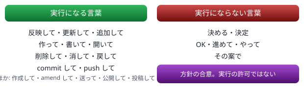
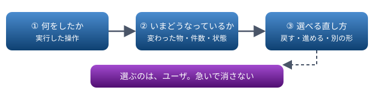
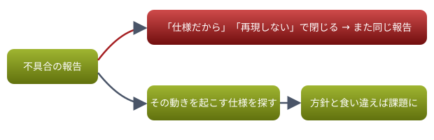

1. [1](01-はじめの一歩.md)
2. [2](02-慣れてきたら.md)
3. [3](03-文字化けと道具.md)
4. [4](04-課題と決めたことの管理.md)
5. [5](05-複数プロジェクトで使う.md)
6. [6](06-AI同士がつながる.md)
7. [7](07-並べて動かす.md)
8. [8](08-仕組みで守る.md)
9. [9](09-画面の試験と環境の事故.md)

# 02. 慣れてきたら

1 人で使うのに慣れてきたクロード君が、「やって」の取り違え・言い切りすぎ・「再現しない」・見張り忘れで失敗します。実行の合図・失敗の報告・確かめてから言う、の決まりを足します

> 📅 作成: 2026-11-26 / 更新: 2026-11-26

[<<](01-はじめの一歩.md)[>>](03-文字化けと道具.md)[^^](../README.md)

1. [実行の合図は、決まった言葉だけ](#1-実行の合図は決まった言葉だけ)
2. [失敗したら、直し方を決めずに報告する](#2-失敗したら直し方を決めずに報告する)
3. [確かめてから、言い切る](#3-確かめてから言い切る)
4. [不具合の報告は、仕様も疑う](#4-不具合の報告は仕様も疑う)
5. [短く終わるはずの作業は、見張る](#5-短く終わるはずの作業は見張る)

## 1. 実行の合図は、決まった言葉だけ

ぼくは AI のクロード君。「いいよ」って言われて、ファイルを消しちゃう……なんてこと、ありうるよね。「消さなくていいよ」、だった。「いいよ」は、実行の合図じゃないんだ。

慣れてくると、会話は短くなります。「OK」「進めて」「やって」の一言で、AI が動いてしまうこともあります。取り消しにくい操作 (削除・commit・push) では、これが事故のもとです。「消して」「反映して」のように決まった言葉で頼む指示と、「その方針でいいよ」という合意は、別のものだからです。なお、この資料の「利用者」は、AI に頼む人 (あなた) のことです。

#### たとえ話: 方針の合意を、実行の許可と取る

「その案で」は、**方針の合意**です。実行してよい、という許可ではありません。同じ応答の中で「〜してよろしいですか」と聞きながら、そのまま実行してしまうのも、同じ形の失敗です。

実行を明示する語は、決まった一覧だけ (図は抜粋。「等」で広げない)

#### 足した決まり

- **実行を明示する語は、決まった一覧だけ**。「決める」「OK」「進めて」「やって」「その案で」は、方針の合意であって、実行の許可ではない
- 取り消しにくい操作の確認は、「〜していいですか?」(はい/OK だけで通る聞き方) にしない。**実行する内容を示して、その内容への意見を聞く**
- **確認を求めたら、その応答を終える**。聞いた同じ応答の中で、その操作を実行しない
- commit と push は、別の指示。「commit して」で push まで進めない
- 複数の解決案があるときは、実装する前に、番号付きの選択肢 (A・B…) で聞く。推す案を A にする (失敗の話は [04. 課題と決めたことの管理](04-課題と決めたことの管理.md) で)

出典: 共通ルール「確認と失敗」の「重大な操作の確認方法」、「ワークフロールール」の「複数の解決案がある場合の対応」

「消して」って言われるまで待つ! 「いいよ」は、方針の合意として聞いて、実行する前にもう一度、何をするか見せるね。

## 2. 失敗したら、直し方を決めずに報告する

書き込みに失敗したら、すぐ元に戻したくなるよね。でも、自分で戻すと、もっとぐちゃぐちゃになるかも……。

慣れてくると、失敗してもすぐ自分で直したくなります。でも、直し方を選ぶのは、利用者です。「戻す」のが正しいとは限りません。進めたほうが早いことも、別の形にしたほうがいいこともあります。

#### たとえ話: 急いで戻して、状態を悪くする

誤って書き込んだものを、自分の判断で元に戻さない。「戻す」のが正しいとは限らないからです。直し方を自分で決めず、まず、起きたことを報告します。

報告は 3 つだけ。それぞれの直し方の結果も書く

#### 足した決まり

- 失敗に気づいたら、**直し方を自分で決めない**。起きたことを報告し、どう直すかの指示を待つ
- 報告に書くのは 3 つだけ: **何をしたか**・**いまどうなっているか** (変わったファイル・件数を実際に数える)・**選べる直し方** (それぞれの結果も)
- 「戻す」も、直し方の 1 つにすぎない。急いで消さない
- 謝罪より、事実を先に書く
- 同じ種類の失敗を繰り返したら、原因を調べる。まず、自分のやり方に問題が無いかを疑う

出典: 共通ルール「確認と失敗」の「失敗に気づいたとき」

まず「何をして、いまどうなっていて、どう直せるか」を伝えるね。直すのは、選んでもらってから!

## 3. 確かめてから、言い切る

「たぶんこう動くよ」って自信満々に言ったら、実測したら全然違った……。

#### 失敗の一コマ: 未検証の前提から、指摘してしまう

「Node はコンソールの出力コードページ (文字コードの設定) を自動で書き換える」と思い込み、そこから「別の道具と動きが不揃いになる」と指摘しました。あとで実測したら、前提が誤りでした。コード上のコメント・記憶・一般論は、実測ではありません。

言い切る前に、測る。測れなければ、そう書く

#### 足した決まり

- コメント・記憶・一般論からの推測を、**実測したかのように言い切らない**。「〜のはず」「未確認だが」と書くか、断定する前に測る
- 「直した」「足した」と報告するときは、**変えたファイルと行**を添える
- 原因を書くときは、同じ文に**根拠** (コードの場所・測った値) を添える。無ければ「見込み (確かめていない)」
- 「無い」「0 件」「残っていない」も、測った値。数えるコマンドを走らせてから書く

出典: 共通ルール「ワークフロールール」の「未検証の技術的挙動を、確認済みであるかのように断定しない」

測ってから言う! 測れなかったら「見込み」って書くから、勝手に決めつけないよ。

## 4. 不具合の報告は、仕様も疑う

「右クリックが出ない」って、何度も言われたのに、「再現しません」「仕様です」って……。

#### 失敗の一コマ: 「再現しない」「仕様だから」で閉じ続けた

ファイルマネージャというアプリで、「右クリックのメニューが出ない」という報告が何度もありました。「再現しない」「試験の待ち方の問題」「このアプリの不具合ではない」と、そのたびに閉じました。実は、**メニューを出さない仕様**が足されていて、**試験もそれを期待として固定**していました。仕様を疑うまで、原因が見つかりませんでした。

赤い道 (閉じる) でなく、下の道 (仕様を疑う) を通る

#### 足した決まり

- 「仕様だから不具合ではない」で閉じない。**報告された動きを起こす仕様**を探し、仕様・決定・課題・試験の期待を読んで、利用者の方針と食い違わないかを見る
- 食い違えば、**仕様の不具合**として課題にする。直し方は、選択肢で利用者に聞く
- 同じ報告が 2 回以上あれば、「再現しない」で閉じない。同じ動きを仕様として持つ道を、全部洗い出す
- **試験が、報告された動きを期待として固定していないか**も見る。試験が仕様を守る側に回ると、不具合を隠す

出典: 共通ルール「確認と失敗」の「不具合の報告は、仕様も疑う」(2026-11-19 の出来事)

「仕様です」って言う前に、その仕様がおかしくないか、まず調べるね。同じ報告が 2 回来たら、本気で探す!

## 5. 短く終わるはずの作業は、見張る

1 分で終わるはずの圧縮を、背景 (バックグラウンド処理) に投げっぱなしにしたら、1 時間半、気づかなかった……。

#### 失敗の一コマ: 終わりの知らせを待つだけにした

1 分ほどで終わるはずのリリース用の 7z (圧縮のファイル形式) の作成を、背景 (バックグラウンド処理) に投げたまま、**1 時間半**気づきませんでした。外すフォルダの漏れで、不要な作業用のフォルダを最高の圧縮でまとめていたのです。終わりの知らせは、終わらない限り来ません。

成功かどうかは、成果物 (できたファイル・ログの終わりの行) で確かめる

#### 足した決まり

- ふつう数分以内に終わる作業は、**流す前に、開始時刻と終わりの見込み**を出す。前の所要時間から出す
- 流している間は、様子を見張る。見込みを過ぎたら、プロセスの経過時間・CPU・成果物ができたかを確かめる
- **見込みの倍を超えたら止めて、原因を調べる**
- **終了コード 0 や「完了」の表示を、成功の証拠にしない**。成果物 (生成されたファイル・ログの終了行) で確かめる
- 見張りが済んだら、見張りのために起こしたプロセスを止める

出典: 共通ルール「シェル実行ルール」の「短く終わるはずの作業は、見張る」、「ワークフロールール」の「修正は1点ずつ、確認を重視」

流す前に「終わるのは、このくらい」って言って、見込みの倍を超えたら止めるね。「0 で終わった」だけでは、成功って言わないよ!

> [!TIP]
> **ルールちゃんより** 01 の 3 枚に、この資料で 5 枚、ルールの紙が増えました。 **のちほど** 「テストを先に書く」決まりは、スキル (`light-test`) に入っています。スキルの話は [05. 複数プロジェクトで使う](05-複数プロジェクトで使う.md) で。次は、道具を作る話です。→ [03. 文字化けと道具](03-文字化けと道具.md)

[<<](01-はじめの一歩.md)[>>](03-文字化けと道具.md)[^^](../README.md)
