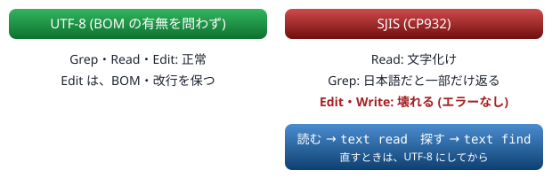
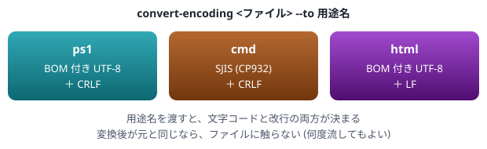
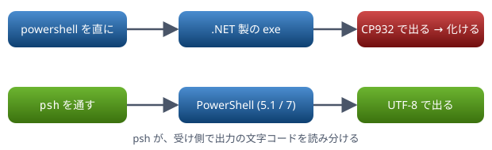
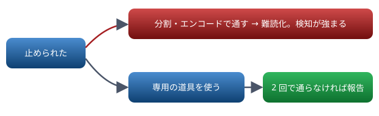

1. [1](01-はじめの一歩.md)
2. [2](02-慣れてきたら.md)
3. [3](03-文字化けと道具.md)
4. [4](04-課題と決めたことの管理.md)
5. [5](05-複数プロジェクトで使う.md)
6. [6](06-AI同士がつながる.md)
7. [7](07-並べて動かす.md)
8. [8](08-仕組みで守る.md)
9. [9](09-画面の試験と環境の事故.md)

# 03. 文字化けと道具

標準の道具だけでは、日本語のファイルを安全に扱えません。クロード君が文字化け・壊れた書き換え・検知に当たって、読む・変換する・PowerShell の出力を UTF-8 に揃える道具と、決まりが生まれます

> 📅 作成: 2026-11-26 / 更新: 2026-11-27

[<<](02-慣れてきたら.md)[>>](04-課題と決めたことの管理.md)[^^](../README.md)

1. [標準の Edit は、SJIS を壊す](#1-標準の-edit-はsjis-を壊す)
2. [文字コードと改行は「組」で決める](#2-文字コードと改行は組で決める)
3. [PowerShell 経由の出力は、UTF-8 に揃える](#3-powershell-経由の出力はutf-8-に揃える)
4. [ブロックされたら、回避しない](#4-ブロックされたら回避しない)

## 1. 標準の Edit は、SJIS を壊す

古い .cmd ファイルを 1 行直したら、「成功」って返ってきても、日本語が化けてるかも……。

Windows の古い資料やバッチには、SJIS (CP932) という古い文字コードのファイルが残っています。AI の標準の道具 (読む Read・探す Grep・書き換える Edit・新しく書く Write) は、UTF-8 を前提に作られています。そのため、SJIS のファイルでは、道具ごとに別々の壊れ方をします。

#### たとえ話: 「成功」と返ったのに、中身が壊れる

SJIS のファイルを、標準の Edit で書き換えると、こうなります。Edit はファイルを UTF-8 として読むので、読めないバイトが「�」(U+FFFD) になって、そのまま書き戻されます。**エラーは出ず、成功が返ります**。Grep は、日本語で探すと一部だけ返り、**0 件ではなく欠けた結果**なので、欠けに気づけません。

文字コードによって、標準の道具が壊れる所が違う

「SJIS のファイルは、専用の道具で読み書きしてね」って、1 枚足しておくよ。

#### 足した決まり

- SJIS のファイルは、Read ではなく **`text read`** で読む。探すのは Grep ではなく **`text find`** (SJIS と UTF-16 も当たる)
- **SJIS のまま Edit で編集しない**。`convert-encoding <path> --to utf8` で UTF-8 にして、Edit で直し、**すぐ元の形に戻す** (cmd なら `--to cmd`。編集中は UTF-8 のまま。戻し忘れると UTF-8 で残る)
- 新しいファイルを Write する前に、**同じ名前のファイルが無いか**を確かめる。一度読んだファイルは、Write が止めずに上書きする
- 一括の置換のあとは、`text find` で探し直す。bat・cmd・reg だけが取り残される

出典: 共通ルール「コーディングルール」の「ツールごとの文字コードの扱い」・「cmd・bat・reg を作る・直す・消す (Windows)」

SJIS は `text` で読んで、直すときは UTF-8 にしてから! 「成功」って返っても、中身を信じすぎないよ。

## 2. 文字コードと改行は「組」で決める

ps1 を書いたら、日本語が化けた。BOM を付け忘れた? 改行は CRLF だっけ LF だっけ……。

ファイルの種類ごとに、決まった文字コードと改行の組があります。BOM は、ファイルの先頭に付ける文字コードの印、CRLF と LF は、改行の記号の種類 (Windows の古い形式は CRLF) です。PowerShell のスクリプト (ps1) は BOM 付き UTF-8 と CRLF、cmd は SJIS と CRLF、HTML は BOM 付き UTF-8 と LF、のように、組で決まります。ところが、Write (ファイルを新しく書く道具) は、BOM の無い UTF-8 と LF で書いてしまいます。

#### 失敗の一コマ: 毎回、手で書き分けて、検知された

文字コードと改行の組を、その場で手で組み立てていました。書き方がセッションごとに変わり、あるときは `WriteAllBytes` (バイト列を直接書く命令) を使って、**ウイルス対策に検知されたことがあります** (この検知が、4 章の「3 回」に入るかは、記録から分かりません)。この「バイト列を直接書く」やり方は、もう使いません。文字コードの変換は `convert-encoding` に任せ、自分でバイト列を触らない決まりにしました。

用途名を 1 つ渡せば、文字コードと改行は「組」で揃う

「文字コードと改行は、用途名で「組」にして直してね」って、1 枚足しておくよ。

#### 足した決まり

- ps1 や HTML を Write で書いたら、**`convert-encoding` で BOM と改行を入れ直す** (`--to ps1`・`--to html`)。cmd は `--to cmd`
- **手で組み立てない**。バイト列を自分で書く道は使わない
- 変換先で表現できない文字があれば、書き換えずに止まる。その文字と行番号が出る
- UTF-8 のファイルの編集は、Edit で安全。BOM の有無と LF / CRLF が保たれる

出典: 共通ルール「コーディングルール」の「ツールごとの文字コードの扱い」。道具は共有の `convert-encoding` (ai-agent-tools)

書いたら `--to ps1` と流すだけ! 組を覚えなくても、道具が決めてくれるんだ。

## 3. PowerShell 経由の出力は、UTF-8 に揃える

PowerShell 経由で道具を動かしたら、日本語が「縺ゅ＞縺…」みたいな変な字になったよ。

Windows には、画面に出す文字の「コードページ」(文字コードの番号) があります。PowerShell を通して .NET 製の道具を動かすと、出力が CP932 (SJIS の仲間) になり、受け取る側が UTF-8 と思って読むので、日本語が化けます。

#### 失敗の一コマ: powershell を直に呼んで、日本語が化けた

`powershell` を直に呼ぶと、**PowerShell 経由で動く .NET 製の exe が CP932 で出力する**ため、日本語が化けました。出力の化けは、呼び方で変わります。

PowerShell の出力は、`psh` を通して UTF-8 に揃える

「日本語が出る道具は、UTF-8 を出す呼び方にしてね」って、1 枚足しておくよ。

#### 足した決まり

- PowerShell のツールが使える環境では、そのツールを使う。**使えない環境で、Bash から ps1 や PowerShell の式を動かすとき** (共通ルールの見出し「PowerShell ツールが無いときは psh で呼ぶ」) は、**`psh <path.ps1>`** か `psh -c "<式>"` を使う。`powershell` を直に呼ばない
- 終了コードは、そのまま返る。判定に使ってよい
- 手を入れられない ps1 (他プロジェクトのもの・外から持ってきたもの) にも効く。`psh` は受け側で読み分ける
- UTF-8 で出す道具 (`git`・`node`・`bun`・`text`・`convert-encoding` ほか) は、Bash から直接呼んでよい。`psh` で包まない

出典: 共通ルール「シェル実行ルール」の「PowerShell ツールが無いときは psh で呼ぶ」

PowerShell の式は `psh` に渡すよ。日本語が、ちゃんと日本語で返ってくる!

## 4. ブロックされたら、回避しない

コマンドが止められたから、文字を分けたり包んだりして、通そうとしたら、もっと怒られた……。

道具を使っていると、コマンドが `EPERM` (許可されていない、という種類のエラー) で止められることがあります。そこで「通る形」を探して書き換えたくなりますが、これは逆効果です。

#### 失敗の一コマ: 回避しようとして、検知を強めた

ウイルス対策に、`Trojan:Win32/FileFix` として **3 回**検知されました。うち **2 回は、止められたコマンドを回避しようとして、自分で作った書き方**でした。文字列を分けたりエンコードしたりすると、難読化にあたり、検知がかえって強まります。バイト列を読んで置換して書き戻す形も、実行ファイルを差し替えるマルウェアと同じ形です。**なぜ検知されたか**は、やりたいこと (日本語のファイルの書き換え) ではなく、**書き方の形**が、マルウェアの動きに似ていたからです (回避のための書き方は、難読化にも見えました)。ウイルス対策の内部の判断は、記録に無く、確かめていません。いまは、文字コードの変換と書き換えを、`convert-encoding` と Edit / Write (SJIS は `text`) で行います。

赤い道 (回避する) でなく、下の道を通る

「ブロックされたら、回避せずに止まって報告してね」って、1 枚足しておくよ。

#### 足した決まり

- コマンドが `EPERM` などで止まっても、**文字列の分割・エンコードで通そうとしない**
- UTF-8 のファイルの書き換えは、**Edit / Write の道具**で行う。バイト列を読んで置換して書き戻す形は、実行ファイルを差し替えるマルウェアと同じ形になる
- 文字コードの変換は、`convert-encoding`。自分でバイト列を触らない
- **2 回目で通らなければ、手を止めて報告する**

出典: 共通ルール「シェル実行ルール」の「ブロックされたら回避しない」

止められたら、決まった道具で 2 回までやって、だめなら「ここで止まったよ」って伝えるね。回り道はしないよ!

> [!TIP]
> **のちほど** ここで出てきた `text`・`convert-encoding`・`psh` は、全部、共有の道具 (`ai-agent-tools`) の仲間です。道具が増えると、課題や決めたことが増えます。次は、それを管理する話です。→ [04. 課題と決めたことの管理](04-課題と決めたことの管理.md)

[<<](02-慣れてきたら.md)[>>](04-課題と決めたことの管理.md)[^^](../README.md)
