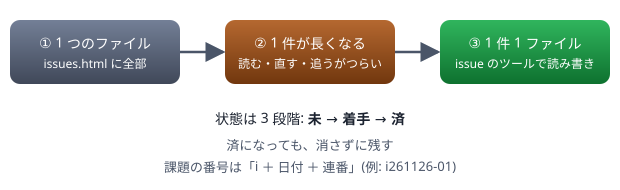
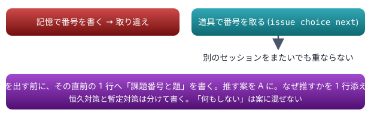
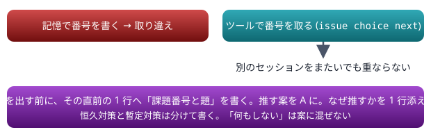
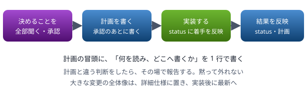
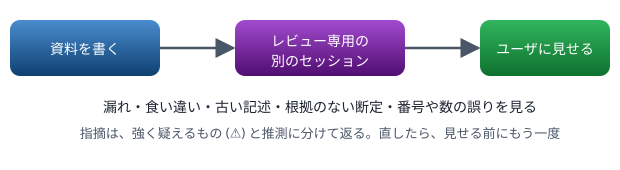

1. [1](01-はじめの一歩.md)
2. [2](02-慣れてきたら.md)
3. [3](03-文字化けと道具.md)
4. [4](04-課題と決めたことの管理.md)
5. [5](05-複数プロジェクトで使う.md)
6. [6](06-AI同士がつながる.md)
7. [7](07-並べて動かす.md)
8. [8](08-仕組みで守る.md)
9. [9](09-画面の試験と環境の事故.md)

# 04. 課題と決めたことの管理

複数のセッションと人で作業するようになると、「これから何をするか」と「何を決めたか」が散らばります。クロード君が番号を取り違えたり、確かめないまま見せたりして、課題・決定・計画の置き場と決まりが生まれます

> 📅 作成: 2026-11-26 / 更新: 2026-11-27

[<<](03-文字化けと道具.md)[>>](05-複数プロジェクトで使う.md)[^^](../README.md)

1. [課題は、1 件 1 ファイルで持つ](#1-課題は1-件-1-ファイルで持つ)
2. [決めることは、番号付きの選択肢で聞く](#2-決めることは番号付きの選択肢で聞く)
3. [機能の追加は、計画と承認が先](#3-機能の追加は計画と承認が先)
4. [書いた資料は、見せる前にレビューを通す](#4-書いた資料は見せる前にレビューを通す)

## 1. 課題は、1 件 1 ファイルで持つ

やることをメモしておいたら、増えすぎて、どこに何を書いたか分からなくなっちゃった……。

「これから解決すること」は、課題 (issue) として記録します。最初は、1 つの HTML ファイル (`issues.html`) に全部を書きました。1 件が長くなってくると、1 件ごとに別のファイルへ分ける方式 (`issue`) に移してよい、と決めました。いまは、`issue` という共有の道具 (03 の仲間です) で読み書きします。

#### たとえ話: 1 つのファイルに、全部を書く

1 つのファイルに全部を書くと、1 件が長くなって、読むのも、直すのも、追うのもつらくなります。1 件 1 ファイルなら、別々の課題は別のファイルなので、必要な 1 件だけを読んで直せます。

課題の管理は、管理なし → 1 つのファイル → 1 件 1 ファイル、と変わった

「課題は、1 件 1 ファイルで持ってね」って、1 枚足しておくよ。

#### 足した決まり

- 課題は `notes/40_issues/` に置き、グループ (章) で束ねる。移す前は `issues.html` の 1 ファイル、移したあとは 1 件 1 ファイル (`issue` で読み書き)。**移行は、利用者に頼まれてから**始め、移したあとは元の方式へ戻さない。移す前に、課題の状態が正しいかを確かめる
- グループごと片付いたら、保管 (`archived` フォルダ) へ移す。移すときに、本文を書き換えない
- 番号は **`i` ＋ 立てた日 (`yymmdd`) ＋ 連番** (`i261126-01`)
- 状態は**未・着手・済**の 3 段階。済んだ課題は消さず、済で残す
- 不具合の課題は、新機能の課題より先に進める
- 課題を立てる前に、**済と保管を含む既存の課題を全件、探す**。同じ事象の課題があれば、新しく立てずに足す
- 他プロジェクトからの報告に基づく課題は、**報告元の確認が取れるまで「済」にしない**
- 状態 (いまどうなっているか) は status に、課題 (これから何をするか) は issues に。status には課題を書かない

出典: 共通ルール「ワークフロールール」の「課題の管理」

やることは、1 件ずつファイルに。番号と状態が付くから、あとで探せるよ!

## 2. 決めることは、番号付きの選択肢で聞く

「1-A」って書いたら、前の話の「1-A」と、同じ番号になっちゃった……。

直し方が 2 つ以上あるとき、AI は、実装する前に、案を並べて利用者に選んでもらいます。案には、<strong>A・B・C…</strong>と記号を付けます。案の記号は、ア・イ・ウで聞くことも、1・2・3 で聞くこともあり、そろっていませんでした。そこで、**ルールにして、A・B・C に落ち着きました**。決める点が複数あるときは、`1-A`・`2-B` のように番号を振ります。こうすると、「1 は A、2 は B で」と、一部だけ答えられます。

#### 失敗の一コマ: 選択肢の番号が重なる

複数の案件を同時に進めていると、番号が重なります。一覧を見ずに、**記憶や見当で番号を書いて**、別の項目と取り違えました。また、題を「番号 問い」(コロンなし) と書いたため、道具が使った番号として数えませんでした。番号の重複は、振り返りの記録にも残っています。選んだ結果は、決定として 1 件 1 ファイルに残し (`issue decide`)、番号の取り違えを防ぎます。

番号は、道具が取る。案を出すときの書き方も決まっている

「決めることは、番号付きの選択肢で聞いてね」って、1 枚足しておくよ。

#### 足した決まり

- 解決できる案が 2 つ以上あれば、**実装する前に、案を提示して選んでもらう**。独断で 1 つを選ばない
- 案の記号は、**A・B・C…にそろえる** (ア・イ・ウや 1・2・3 は使わない)。**推す案を A** にする。なぜ推すかを 1 行添える
- 決める点が複数あるときは、`1-A` `2-B` の形で番号を振る。複数の案件を同時に進めるときは、**案件をまたいで通し番号**にする
- 番号は、`issue` の決定の仕組みに移したプロジェクトでは、**道具 (`issue choice next`) で取る**。移していないプロジェクトは、会話の中の最大の番号に 1 を足す。どちらも、一覧を出してから指し、記憶や見当で書かない
- 選んだ結果は、決定として 1 件 1 ファイルに残す (`issue decide`)。決定の題は **`番号: 問い`** (コロンあり) の形で書く
- 恒久対策と暫定対策を分けて書く。同じ事象が再発するなら暫定。解決しない案 (何もしない・一部だけ直す) は、選択肢に混ぜない

出典: 共通ルール「ワークフロールール」の「複数の解決案がある場合の対応」

番号は道具で取って、案の前に「何の決めることか」を 1 行で書くね。おすすめは、いつも A!

## 3. 機能の追加は、計画と承認が先

作ってから「こう作りました」って書いたら、設計の穴が見つかって、作り直しになっちゃった……。

新しい機能を足すときや、今の動きを変えるときは、順番が決まっています。**決めることと計画の中身を示して承認をもらう → 計画書を書く → 実装する → 結果を計画に反映する**、です。計画書は、承認のあとに、決まったとおりに書きます。実装してから計画を書くと、書く段階で気づく設計の穴を、作り終えてから見つけることになります。

#### たとえ話: 作ってから、計画を書く

作り終えたあとで穴が見つかると、手戻りは大きくなります。もう 1 つ、聞くことの順番にも決まりがあります。**決めることを、先に全部聞く**。作業の途中で、決めることを聞くために止めると、その間ずっと、利用者を待たせます。

計画の承認は、計画書を書く前にもらう

「作る前に、計画を書いて承認をもらってね」って、1 枚足しておくよ。

#### 足した決まり

- 順は **決めることと計画の中身を示して承認 → 計画書を書く → status に着手を反映 → 実装 → status と計画に結果を反映**。計画書の承認は、書く前にもらう。実装してから計画に書く順にしない (status = いまどうなっているかをまとめた資料。無いプロジェクトでは、この反映は要らない)
- **決めることは、作業の前に全部、1 つずつ選択肢で聞く**。答えをもらってから、作業に入る
- 計画の冒頭に、何を読み、どこへ書くか (対象のプロジェクト・入力・出力) を 1 行で書く。取り違えを、承認の前に見つける
- 前からある動きは、直す前に書き出して、試験で守る (消す・置き換えるときも)
- 実装中に計画と違う判断をしたら、その場で報告する

出典: 共通ルール「ワークフロールール」の「機能を追加・変更するときの順序」「前からある動きを無くさない」

先に計画を見せて、「これで進めていい?」って聞くよ。承認をもらってから、作るね!

## 4. 書いた資料は、見せる前にレビューを通す

計画を書いて「承認してください」って出したら、あとから漏れが見つかって……。

自分で書いたものの漏れには、自分では気づきにくいものです。課題・計画・決定・調査などの資料は、利用者へ見せる前に、**別のセッション (レビュー専用)** に読んでもらいます。レビューする側は、読むだけです。実行・試験・ファイルの変更はしません。

#### 失敗の一コマ: レビューの前に、承認を待つ

レビューを通す前の計画を、そのまま承認待ちに出しました。試験のスクリプトと結果も、足りなさが**あとから**見つかることが多かったのです。そこで、書き終えたら、見せる前にレビューを通す決まりになりました。

レビューは、読むだけ。直すのは、書いた側

「書いた資料は、見せる前にレビューを通してね」って、1 枚足しておくよ。

#### 足した決まり

- 課題・決定・計画・調査・仕様の資料・試験のスクリプトと結果などを書いたら、**利用者へ見せる前**に、レビュー専用のセッションに読んでもらう
- 実装の**前**には、課題と計画の漏れをレビューしてもらう。実装の**後**、試験の前には、ソースをレビューしてもらう
- 返ってきた指摘は、**書いた側が 1 件ずつ**、起きうるか・直すべきかを確かめる。直すものは直し、直さないものは条件を記録する
- 返らないときは「レビュー未了」と記録して先へ進んでよい。ただし、利用者に見せる資料は、未了のまま見せない

出典: 共通ルール「ワークフロールール」の「書いた資料は、見せる前にレビューを通す」「実装の前後のレビューを、別の子セッションにさせる」

書いたら、まず別のセッションに読んでもらうよ。見せるのは、そのあと!

> [!TIP]
> **のちほど** 「別のセッション」は、人がその都度呼ぶこともできますが、AI が別のセッション (サブエージェント) を呼ぶこともできます。それは [07. 並べて動かす](07-並べて動かす.md) で。次は、プロジェクトが増えたときの話です。→ [05. 複数プロジェクトで使う](05-複数プロジェクトで使う.md)

[<<](03-文字化けと道具.md)[>>](05-複数プロジェクトで使う.md)[^^](../README.md)
