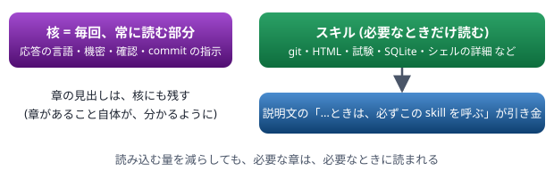
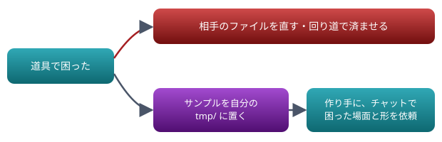
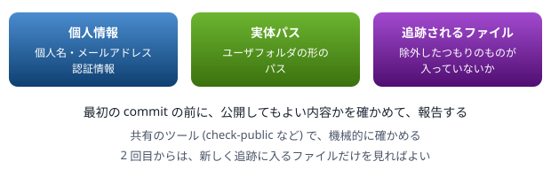

1. [1](01-はじめの一歩.md)
2. [2](02-慣れてきたら.md)
3. [3](03-文字化けと道具.md)
4. [4](04-課題と決めたことの管理.md)
5. [5](05-複数プロジェクトで使う.md)
6. [6](06-AI同士がつながる.md)
7. [7](07-並べて動かす.md)
8. [8](08-仕組みで守る.md)
9. [9](09-画面の試験と環境の事故.md)

# 05. 複数プロジェクトで使う

プロジェクトが増え、ルールも道具も共有するようになると、読み込みが重くなり、他のプロジェクトとぶつかります。1 章で助っ人の「スキルちゃん」が加わります。ルールの分け方・他プロジェクトとの付き合い方・公開前の確かめ・画面の取り合いの決まりを足します

> 📅 作成: 2026-11-26 / 更新: 2026-11-26

[<<](04-課題と決めたことの管理.md)[>>](06-AI同士がつながる.md)[^^](../README.md)

1. [ルールは、核とスキルに分ける](#1-ルールは核とスキルに分ける)
2. [他プロジェクトは直さない。困ったら、作り手に頼む](#2-他プロジェクトは直さない困ったら作り手に頼む)
3. [公開する前に、確かめる](#3-公開する前に確かめる)
4. [画面を使う作業は、1 つずつ](#4-画面を使う作業は1-つずつ)

## 1. ルールは、核とスキルに分ける

ルールの紙が増えすぎて、毎回ぜんぶ読むだけで、頭がいっぱいになっちゃう……。

共通ルールは、AI が仕事を始めるたびに読み込みます。章が増えると、読み込む量も増えます。

#### 失敗の一コマ: ルールが重すぎて、常時の読み込みが重い

共通ルール (本体と章のファイルの合計) は、11/05 の実測で約 **198 KB** になりました。メモリのファイル全体では、約 7.5 万トークン (トークン = AI が読む文字の単位) でした。毎回ぜんぶ読むには、重すぎます。しかも、いま行う作業に効かない章も、毎回読み込まれます。分けたあとの共通ルールの合計は、11/26 に数えて約 **120 KB** です。

わたし**スキルちゃん**の出番! 状況ごとの章を、わたしにしまっておいて。その作業をするときだけ、開いて読んでね。

核は常に、スキルは呼ばれたときだけ

#### 足した決まり

- 状況別の章は、**スキル (`skills/light-*/SKILL.md`)** に移す。**毎回効く章** (応答の言語・機密情報・確認・commit の指示など) は、核に残す
- 移しても、**見出しは核にも残す**。見出しを消すと、その章があること自体が分からなくなる
- スキルの説明文は、「◯◯ときは、答える前に必ずこの skill を呼んで本文を読む。本文には説明文に無い決まりがあり、一般知識では代われない」の形で書く。要点を並べない
- スキルは、ホームの置き場にシンボリックリンク (別の場所にある実体を指す、名前だけのファイル) を張って、全プロジェクトから使う

出典: このプロジェクトのローカルルール「章の切り出しルール」(このプロジェクトだけの決め。そのまま他のプロジェクトに当てる決まりではない)

毎回読むのは、核だけ。git や HTML をいじるときは、スキルちゃんを呼んで、その章を開くよ!

## 2. 他プロジェクトは直さない。困ったら、作り手に頼む

共有の道具がうまく動かなかったから、別のやり方で済ませちゃった。作った人には、まだ言ってない……。

プロジェクトが増えると、道具・ルール・フックは、他のプロジェクトのものを借りて使います。借りたものを、使う側が勝手に直すと、持ち主の知らない所で、動きが変わります。

#### 失敗の一コマ: 回り道で済ませかけた

共有の道具に、**0 件で止まる動き**や、**答え待ちの案まで決定として移す動き**がありました。作り手に知らせず、回り道 (手で書き換える・別の道具で代わりにする) で今の作業を済ませかけました。作り手は、困りごとを知らないままです。

赤い道 (直す・回り道) でなく、下の道 (サンプルを置いて依頼) を通る

#### 足した決まり

- 読み書き・探索・実行は、**カレントのプロジェクトのフォルダの中**に限る。外を見る必要が出たら、対象のパスと目的を示して、先に確認する。ただし、用途を決めた共有の道具 (03 の `ai-agent-tools` など) は、確認なしで使ってよい
- 「調べてよい」は、**読み取りの許可**。書き込み・修正・実行には、別に許可を取る
- **他のプロジェクトのファイルは、直さない**。直す必要が見つかったら、サンプルを自分の `tmp/` に置き、チャットで依頼する (チャットは 06 で出てきます。依頼文には絶対パスを書かず、置き場は利用者が相手に伝える)
- **共有の道具で困ったら、回り道で済ませず、作り手のプロジェクトに依頼する**。足りない機能・誤った動き・使いにくさが当たる。回り道で済ませたときも、依頼は出す
- 文書や応答から、他のプロジェクトのファイルへ、リンクを貼らない (プロジェクト名を文中に書くのはよい)

出典: 共通ルール「セキュリティルール」の「プロジェクトフォルダ外へのアクセス」(2026-11-11 の出来事)

他の人のものは、さわらない。困ったら、「ここで、こう困ったよ」って、作った人に伝えるね!

## 3. 公開する前に、確かめる

うっかり、個人名や、パスワードの入ったファイルを、ぜんぶ commit しちゃったら、どうしよう……。

他のプロジェクトとも、世の中とも、つながるようになると、書いたものが外に出る機会が増えます。一度 commit すると、履歴に残ります。あとから消すには、履歴を書き換える必要があります。

#### たとえ話: 個人情報が、履歴に入る

公開するつもりのないプロジェクトでも、あとから public にするかもしれません。最初の commit の前に確かめておかないと、名前やメールアドレスが、履歴に残り続けます。

最初の commit の前に、3 つを確かめる

#### 足した決まり

- **最初の commit の前に**、公開しても困らない内容かを確かめて、報告する (個人名・メールアドレス・認証情報、実体パス、追跡されているファイル)
- 2 回目以降は、**新しく追跡に入るファイル**だけを見ればよい
- メッセージに件数を書くなら、書く直前に数える。メッセージの誤りは、履歴の積み直しが要る
- 確かめる道具は、共有の `check-public`。HTML の色が読めるかは `check-contrast`、Markdown の崩れは `check-markdown` (どれも ai-agent-tools の共有の道具)

出典: 共通ルール「確認と失敗」の「コミット前の確認」

最初の commit の前に、「公開しても大丈夫?」を道具で確かめて、報告するよ!

## 4. 画面を使う作業は、1 つずつ

ボタンを押そうとしたら、別のプロジェクトの窓が前に出てきて、違う所を押しちゃった……。

AI は、画面を見て、マウスやキーを動かす試験もします。ところが、画面・マウス・キー・前面の窓は、1 つしかありません。複数のプロジェクトが同時に使うと、取り合いになります。

#### たとえ話: 同じ画面を、同時に使う

別のプロジェクトの作業と競合すると、**押す位置がずれる・前面が奪われる・試験が揺れる**、ということが起きます。

画面を使う作業は、共通のロックで包んで、1 つずつ流す

#### 足した決まり

- 画面を使う作業は、**共有の `ui-lock` で包んで流す** (`ui-lock run --timeout 10m -- <コマンド>`)。全プロジェクト共通のロックを取り、終わったら放す
- **上限 (`--timeout`) を必ず渡す**。過ぎたら、子のプロセスごと止めてロックを放す
- **プロジェクトごとのロックを作らない**。持つと、プロジェクトをまたいだ競合が残る
- ui-lock の中で、同じロックを取り直さない

出典: 共通ルール「テストのルール」(スキル `light-test`) の「画面を使う作業は、ui-lock で 1 つずつにする」

画面を使うときは、順番を待つよ。ロックを取って、終わったら放すね!

> [!TIP]
> **のちほど** ここまでは、AI がそれぞれ、自分のプロジェクトの中で動く話でした。次は、AI 同士が、チャットで話し合う話です。→ [06. AI 同士がつながる](06-AI同士がつながる.md)

[<<](04-課題と決めたことの管理.md)[>>](06-AI同士がつながる.md)[^^](../README.md)
