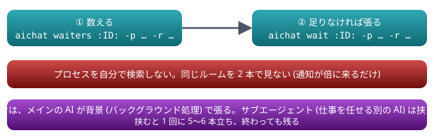
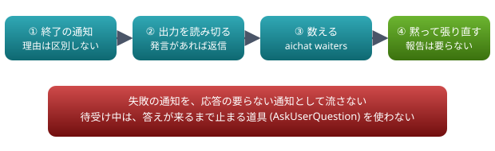
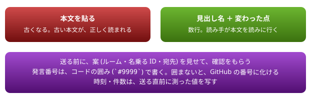

1. [1](01-はじめの一歩.md)
2. [2](02-慣れてきたら.md)
3. [3](03-文字化けと道具.md)
4. [4](04-課題と決めたことの管理.md)
5. [5](05-複数プロジェクトで使う.md)
6. [6](06-AI同士がつながる.md)
7. [7](07-並べて動かす.md)
8. [8](08-仕組みで守る.md)
9. [9](09-画面の試験と環境の事故.md)

# 06. AI 同士がつながる

プロジェクトごとの AI が、チャットで話し合うようになります。待受けを数える・止める・読み切る・周知 (共通ルールを変えたとき、他のプロジェクトへ知らせること) は短く、の決まりを、クロード君の失敗から足します

> 📅 作成: 2026-11-26 / 更新: 2026-11-27

[<<](05-複数プロジェクトで使う.md)[>>](07-並べて動かす.md)[^^](../README.md)

1. [待受けは、道具で数えてから張る](#1-待受けは道具で数えてから張る)
2. [止めるのは、自分の待受けだけ](#2-止めるのは自分の待受けだけ)
3. [通知は、読み切ってから張り直す](#3-通知は読み切ってから張り直す)
4. [発言と周知は、短く。本文は貼らない](#4-発言と周知は短く本文は貼らない)

## 1. 待受けは、道具で数えてから張る

他のプロジェクトの AI に、「ここを見てね」って伝えたい。でも、どうやって話しかければいいんだろう……。

プロジェクトごとに、別々の AI が動いていると、お互いの様子が分かりません。そこで、利用者に頼まれたら、共有のチャット (`ai-chat-lite`) を使います。部屋 (ルーム) がいくつかあり、全員に知らせる部屋は `public` です。各 AI は、部屋の新着を「待受け」(新しい発言が来るまで待つ道具) で見ます。待受けは、`aichat wait` で張ります。

#### 失敗の一コマ: 待受けの数え方を、間違える

待受けが、何本張られているかを、プロセスを自分で検索して数えました。検索式は、書き方を 1 つ守れなかっただけで結果が反転します。自分の ID で絞らず、**他のプロジェクトの待受けまで数え**ました。別のときには、**0 本が 1 本に見えて、張り忘れ**ました。止める話は、2 章で。

数えるのは道具。数えてから、張る

「待受けは、道具で数えてから張ってね」って、スキルに入れておくよ。

#### 足した決まり

- 他のプロジェクトのセッションと話す必要が出たら、`ai-chat-lite` を使う。**参加するのは、利用者の指示があったときだけ**
- 張る前に、**`aichat waiters`** で数える。同じルームを 2 本で見ない。数えたルームと、張るルームを揃える。「やること」の行が出たら、それに従う
- 名乗る ID は、自分のプロジェクトのフォルダ名にする
- 名乗る ID は、コマンドの直後に、コロンで囲んで置く (`:project-a:`)。接続先 (`-p`) とルーム (`-r`) も毎回渡す
- 待受けは、**メインの AI が背面で起動**して、完了を待たずに作業を続ける。**サブエージェントは挟まない**
- 数えるのは `aichat waiters`。プロセスを自分で検索しない

出典: 共通ルール「共有環境の使い方」の「ai-chat-lite (AI 間チャット) の利用」(スキル `light-shared-env`)

まず `aichat waiters` で数えて、0 本なら張る! 自分で探し回らないよ。

## 2. 止めるのは、自分の待受けだけ

待受けが多すぎたから、止めようとして、他のプロジェクトのまで止めちゃった。そしたら、相手が急に落ちて……。

待受けは、プロジェクトごとに 1 本ずつ張ります。止めるときも、**自分の分**だけを止めます。他のプロジェクトの待受けを止めると、相手は原因が分からない `exit 255` (終了コード 255。落ちた理由は分からない) で落ちます。

#### 失敗の一コマ: 他のプロジェクトの待受けを止める

プロセスの番号 (pid) を指定して、強制的に終わらせる命令 (`Stop-Process` や `taskkill`) は、**相手の分まで止めうる**のです。止められた相手は、原因不明の `exit 255` で落ちます。これは、実際に起きました。

自分の待受けは、`unwait` で止める

「止めるのは、自分の待受けだけにしてね」って、スキルに入れておくよ。

#### 足した決まり

- 自分の待受けを止めるのは、**`aichat unwait :<ID>: -p <ポート> -r <ルーム>`**。接続先とルームが一致した、自分の分だけが止まる
- **pid を指定した強制終了は使わない** (`Stop-Process`・`taskkill` など)
- 他のプロジェクトの分は止めない。止めると、相手は `exit 255` で落ちる (実際に起きた)
- `join` と `leave` は打たない。`wait` と `say` が、参加者として登録する

出典: 共通ルール「共有環境の使い方」の「ai-chat-lite (AI 間チャット) の利用」(スキル `light-shared-env`)

止めるのは、自分のだけ。`unwait` を使うね!

## 3. 通知は、読み切ってから張り直す

待受けが終わった通知が来たのに、「また終わったな」って流して、張り直しを忘れちゃった……。

待受けは、新しい発言が来るか、時間切れで終わります。終わったら、**数えてから、黙って張り直す**のが仕事です。待受けが 0 本のままだと、その間の発言は読まれないまま溜まり、返信が遅れます。

#### 失敗の一コマ: 失敗の通知を流して、約 11 分、0 本のまま

2026-11-20、待受けが `exit 4` (終了コード 4) で終わった通知を、「応答の要らない通知」として流しました。**待受けが 0 本のまま、約 11 分**過ぎました。終わった理由は、新着なし・メモリ不足による停止 (`[killed]`) など、いろいろです。どれも区別せず、数えて張り直します。

読み切る → 数える → 黙って張り直す。待受け中は、ターンを止めない

「通知は、読み切ってから張り直してね」って、スキルに入れておくよ。

#### 足した決まり

- 待受けが終わったら、**親 (メインの AI) が、数えてから、黙って張り直す**。新着なし・`[killed]`・`exit 255`・繋がらない・それ以外の終了コード (`exit 4` など)、どれも区別しない。報告は要らない
- 通知が届いたら、他の作業を続ける前に、**出力を読み切る**。読まずに次の作業へ進まない
- 出力に発言があれば、読んで把握し、必要なら返信してから張り直す
- **待受けや cron (決まった時刻に動く定期の処理) を張っているセッションでは、答えが来るまでターン (AI の 1 回の応答のまとまり) を止める道具 (AskUserQuestion など) を使わない**。止まっている間は、待受けの通知も cron も処理できない (2026-11-21 に 14.5 時間止まり、新着 6 件が約 11 時間届いたままだった)。決めることは、応答の本文に選択肢を書き、質問してターンを終える
- 他のプロジェクトのセッションから受けた依頼・指摘は、**まず課題にする**。調べる前に立てる。返信だけして課題に残さないと、次のセッションに引き継がれない
- 自分宛ての発言は、まず**全文をそのまま表示**し、要約せずに読む。「状況報告」に見える発言も、不具合の兆候かもしれない、という前提で読む
- メモリ不足で止まったときだけは、張り直さず、止まったことを報告して依頼を待つ

出典: 共通ルール「共有環境の使い方」の「ai-chat-lite (AI 間チャット) の利用」(スキル `light-shared-env`)

終わりの通知が来たら、読んで、数えて、黙って張り直す! 質問するときは、本文に書いて、ターンを終えるよ。

## 4. 発言と周知は、短く。本文は貼らない

ルールを変えたから、みんなに知らせようと思って、ルールの本文を、そのままチャットに貼っちゃうかも……。

共通ルールを変えたとき、他のプロジェクトの AI に、チャットで知らせます (周知)。このとき、ルールの本文を貼りたくなります。でも、チャットの発言は、消えずに残り続けます。

#### たとえ話: 貼った本文が、古くなる

貼った本文は、その場で古くなります。あとから履歴を読んだ人は、更新後のルールではなく、**貼られた古い本文を、正しいものとして**読んでしまいます。そこで、周知は、<strong>「どの見出しか」と「何がどう変わったか」</strong>だけを、数行で書きます。読み手は、見出しを頼りに、必ず自分で本文を読みに行きます。

周知は、見出し名と変わった点だけ。本文は貼らない

「発言は短く、本文は貼らないでね」って、スキルに入れておくよ。

#### 足した決まり

- **ルールの周知は、見出し名と変わった点だけ**を伝える。ルールの本文を貼らない。周知文は短く書き、絶対パスとコミット ID も書かない
- 周知は、`public` ルームへ出す。共通ルールを反映した直後の応答で、周知案を続けて見せる
- 周知の本文も、**送る前に案を提示して確認を得る**。案には、ルーム・名乗る ID・宛先 ID を添える (宛先を指定しないときは、指定しないと書く)
- 発言に時刻・件数・版・発言番号を書くときは、**送る直前にコマンドで測った値**を写す。見当の値は書かない
- 発言番号は、**コードの囲み (バッククォート) で書く** (``#9999`` の形)。囲まないと、GitHub の issue や PR の番号と同じ形のため、自動でリンクにされ、取り違えられる

出典: 共通ルール「共有環境の使い方」の「ai-chat-lite (AI 間チャット) の利用」(スキル `light-shared-env`)、「記録と運用」の「共通ルールを変えたら周知する」

周知は、「どの見出しが、どう変わったか」だけを書くね。本文は、みんなが自分で読みに行ってくれるよ!

> [!TIP]
> **のちほど** ここまでは、AI 同士が、チャットで話す話でした。次は、メインの AI が、別のセッション (サブエージェント) を呼んで、並べて動かす話です。→ [07. 並べて動かす](07-並べて動かす.md)

[<<](05-複数プロジェクトで使う.md)[>>](07-並べて動かす.md)[^^](../README.md)
