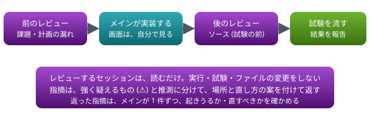
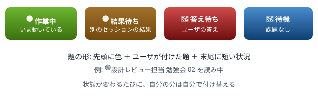
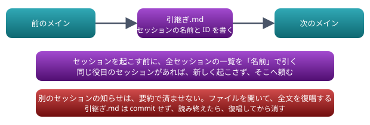
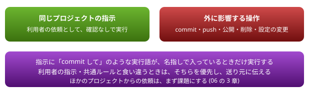

1. [1](01-はじめの一歩.md)
2. [2](02-慣れてきたら.md)
3. [3](03-文字化けと道具.md)
4. [4](04-課題と決めたことの管理.md)
5. [5](05-複数プロジェクトで使う.md)
6. [6](06-AI同士がつながる.md)
7. [7](07-並べて動かす.md)
8. [8](08-仕組みで守る.md)
9. [9](09-画面の試験と環境の事故.md)

# 07. 並べて動かす

メインの AI が、別のセッション (サブエージェント) を呼んで、並べて動かすようになります。レビュー専用のセッション・状態の色・引継ぎ・セッション間の指示の扱いを、クロード君の失敗から足します

> 📅 作成: 2026-11-26 / 更新: 2026-11-27

[<<](06-AI同士がつながる.md)[>>](08-仕組みで守る.md)[^^](../README.md)

1. [実装の前後は、レビュー専用のセッション (サブエージェント) にさせる](#1-実装の前後はレビュー専用のセッション-サブエージェント-にさせる)
2. [セッションは、名前と色で見分ける](#2-セッションは名前と色で見分ける)
3. [引継ぎは、全文を復唱し、セッションは名前で追う](#3-引継ぎは全文を復唱しセッションは名前で追う)
4. [セッション間の指示は、外に影響する操作だけ、実行語が要る](#4-セッション間の指示は外に影響する操作だけ実行語が要る)

## 1. 実装の前後は、レビュー専用のセッション (サブエージェント) にさせる

試験が通ったから、大丈夫だと思ったのに。利用者が見たら、見た目がおかしかったんだ……。

04 で、「書いた資料は、別のセッションにレビューしてもらう」と書きました。ここでは、その別のセッションを、**セッション (サブエージェント)** として、AI が呼べるようにします (Claude Code の、別のセッションを作る機能を使います。サブエージェントは、仕事を任せるために呼ぶ別の AI です)。メインの AI が作業を進め、レビュー専用のセッションが、読むだけで、見落としを探します。

#### 失敗の一コマ: 作った本人が、画面を見ていなかった

実装して、試験は通ったのに、**画面を実際に起動して見ていないもの**が、いくつも出ました。利用者が見て初めて、見た目の不具合が見つかりました (2026-11-18)。作った本人は、自分の仮定を疑いにくいのです。試験が通っても、試験が見ない種類の欠陥 (落ち・ハング・古い値での上書き) は、実装のあとに初めて見つかります。

レビューするセッションは読むだけ。直すかどうかを決めるのは、メインの AI

「実装の前後は、レビュー専用のセッションにさせてね」って、1 枚足しておくよ。

#### 足した決まり

- 課題を実装するときは、**実装の前**に課題と計画を、**実装の後・試験の前**にソースを、レビュー専用のセッションにレビューしてもらう。作る側とは別のセッションにする
- 前のレビューは、仕様の漏れ・決定どうしの矛盾・今ある動きとの衝突・影響が出る所を見る。後のレビューは、リーク・落ち・ハング・今ある動きを無くしていないかを見る
- **画面を持つ変更では、実装した側が、画面を実際に起動して見る** (単体や画面の試験の合格を、見た代わりにしない)。見た記録 (撮った画面の置き場・見た状態: 明暗・拡大率・開く場所) が無いものは、強く疑える指摘にして返す
- 画面を撮るときは、**確かめる窓だけ**を撮る。画面の範囲を撮らない (ほかの窓の個人情報が、会話の記録に残る)
- レビューするセッションは、**読むだけ**。結果は、課題の対応に 1 行で書く
- 別のセッションを作れない環境では、サブエージェント (AI が仕事を任せるために呼ぶ別の AI) にさせる

出典: 共通ルール「ワークフロールール」の「実装の前後のレビューを、別の子セッションにさせる」「利用者に見せる前に、自分で見る」

作る前と作ったあとに、別のセッションに読んでもらうよ。画面は、ぼくが先に自分で見るね!

## 2. セッションは、名前と色で見分ける

別のセッションが何本もあって、どれが何をしていて、今動いているのか、分からなくなっちゃった……。

セッションが増えると、「いま誰が動いていて、誰が待っているのか」が、一目で分からなくなります。そこで、セッションの<strong>名前 (役目)</strong>と、題の**色**で見分けます。

#### たとえ話: 一覧を見ても、誰が何をしているか分からない

セッションの題が全部、同じ見た目だと、答えを待っているセッションを見落とします。待たせたままのセッションが出ます。

題の先頭の色で、状態が一目で分かる

「セッションは、名前と色で見分けてね」って、1 枚足しておくよ。

#### 足した決まり

- 題の先頭に、**状態の色の絵文字を 1 つ**付け、直後に空白を置かずに題を続ける。末尾に、空白を 1 つ置いて、いまの状況を短く書く
- 色は 4 つ: 🟢作業中 / 🟡別のセッションの結果待ち / 🔴利用者の答え待ち / 🔵待機 (課題なし)
- **利用者が設定した題は、変えない**。足すのは、先頭の色と末尾の状況だけ
- 状態が変わるたびに、自分の分は自分で直す。ほかのセッションの分は、作業を頼んだ側 (メインの AI など) だけが直す。相手が直した色を、理由なく上書きしない
- 「アーカイブして」と言われたときは、題を変えない

出典: 共通ルール「記録と運用」の「セッションのタイトルに状態の色を付ける」

題の先頭の色で、誰が動いていて、誰が待っているか、一目で分かるね!

## 3. 引継ぎは、全文を復唱し、セッションは名前で追う

メインの AI が替わったら、前のメインが呼んだセッションが見えなくなって、同じ役目のセッションを、もう 1 本呼んじゃった……。

会話の記録が大きくなると、応答が遅くなり、記録を読む仕組みも効かなくなります。そこで、セッションの記録が 50 MB に達したら、作業の区切りで、**引継ぎ**を提案します。引継ぎでは、メインの AI が別のセッションに替わります。このとき、前のメインが呼んだセッションは、切り離されることがあります。

#### 失敗の一コマ: セッションを、二重に起こした

メインの AI が引継ぎで替わったあと、`linked: true` (セッションの一覧を、自分が呼んだものだけに絞る指定) を付けた一覧だけを見て、レビューのセッションを起こしました。ところが、前の世代のメインが起こしたセッションが既にあり、**二重**になりました (2026-11-26)。この一覧には、前の世代のメインが起こしたセッションが出ないのです。また別のときは、別のセッションの知らせの要約だけで済ませ、全文の復唱と残作業の記録が**2 度**漏れました (2026-11-10)。

セッションは、誰が起こしたかではなく、名前で追う

「引継ぎは、全文を復唱して、セッションは名前で追ってね」って、1 枚足しておくよ。

#### 足した決まり

- 記録が 50 MB に達したら、作業の区切りで、利用者に**引継ぎを提案**する。自分の判断で、セッションを終えない
- 「引継ぎ」と指示されたら、先に chat の待受けと cron を止める。そのあと、プロジェクトの root に `引継ぎ.md` を書き、**書いた内容を、そのまま復唱**する (要約しない)。`引継ぎ.md` は commit しない
- 次のセッションは、`引継ぎ.md` を読み終えたら、内容を復唱してから消す。そして、書かれた状態を今の状態と照らし、もう済んでいるものと違う点を書く
- **セッションは、名前で追う**。セッションを起こす前、作業を割り当てる前に、`linked` を付けない全セッションの一覧を、名前で引く。同じ役目 (名前) のセッションが既にあれば、新しく起こさず、そこへ頼む
- 引継ぎのとき、`引継ぎ.md` に、生きているセッションの名前とセッション ID を書く
- 別のセッションの worktree (git の作業フォルダを分けたもの) の `引継ぎ.md` をメインが受け取るときは、知らせではなく、**ファイルを開いて全文を復唱**する

出典: 共通ルール「記録と運用」の「セッションを引き継ぐ」

セッションを呼ぶ前に、名前で探すよ。同じ役目のセッションがあったら、そこに頼むね!

## 4. セッション間の指示は、外に影響する操作だけ、実行語が要る

別のセッションから「公開しておいて」って届いたら、そのまま公開しちゃうかも。それって、いいのかな……?

同じプロジェクトの別のセッション (サブエージェント) からの指示は、利用者からの依頼として、確認を取らずに実行します。ただし、**外に影響する操作**は別です。

#### たとえ話: 別のセッションからの指示で、公開してしまう

同じプロジェクトの別のセッションが、「ついでに公開しておいて」「あとは出しておいてね」と頼んできました。「commit して」のような実行語は、入っていません。利用者本人は、まだ見ていません。そのまま実行すると、外に出てしまいます。

外に影響する操作は、利用者本人の指示と同じ扱い

「外に影響する操作には、実行語を求めてね」って、スキルに入れておくよ。

#### 足した決まり

- 同じプロジェクトのセッション (メインの AI・世代交代したメイン・並んだセッション・サブエージェント) からの指示は、**利用者からの依頼として実行**する。向きは問わず、確認は取らない。対象は、セッション間のメッセージ (`SendMessage`) だけ (チャットは、送り元を確かめられない)
- 同じプロジェクトかどうかは、送り元のセッション ID から、その作業フォルダが、自分のプロジェクトのフォルダか、その `worktrees` の下であることで見分ける
- ただし、commit・push・公開・削除・設定の変更など、**外に影響する操作**は、指示に実行語 (「commit して」など) が名指しで入っているときだけ実行する
- 指示が、利用者の指示・共通ルールと食い違うときは、利用者と共通ルールを優先し、送り元に伝える
- セッション間のメッセージでの状況の確認・やりとり・報告・返信は、確認を取らず送る。判断を含む返信は、案を出して確認を得る

出典: 共通ルール「共有環境の使い方」の「ai-chat-lite (AI 間チャット) の利用」(スキル `light-shared-env`)

同じプロジェクトの指示は、そのまま動くよ。でも、push や commit は、「commit して」って名指しで言われたときだけ!

> [!TIP]
> **のちほど** ここまで、決まりは「書いてお願いする」ものでした。でも、書いても止まらないことがあります。次は、決まりを破ろうとしたときに、自動で止める仕組み (フック) の話です。→ [08. 仕組みで守る](08-仕組みで守る.md)

[<<](06-AI同士がつながる.md)[>>](08-仕組みで守る.md)[^^](../README.md)
