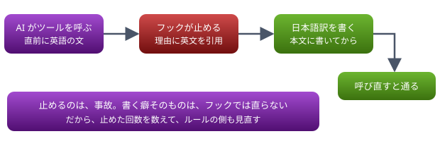
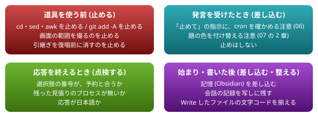

1. [1](01-はじめの一歩.md)
2. [2](02-慣れてきたら.md)
3. [3](03-文字化けと道具.md)
4. [4](04-課題と決めたことの管理.md)
5. [5](05-複数プロジェクトで使う.md)
6. [6](06-AI同士がつながる.md)
7. [7](07-並べて動かす.md)
8. [8](08-仕組みで守る.md)
9. [9](09-画面の試験と環境の事故.md)

# 08. 仕組みで守る

書いたルールを、AI が守れないことがあります。そこで、破ろうとしたら自動で止める仕組み (フック) を足します。助っ人の「フックくん」と一緒に、英語の混入・失敗した編集の後の commit などを止めます

> 📅 作成: 2026-11-26 / 更新: 2026-11-26

[<<](07-並べて動かす.md)[>>](09-画面の試験と環境の事故.md)[^^](../README.md)

1. [書いても止まらないことは、フックで止める](#1-書いても止まらないことはフックで止める)
2. [失敗した編集の後の commit を止める](#2-失敗した編集の後の-commit-を止める)
3. [フックは、止める・差し込む・点検する](#3-フックは止める差し込む点検する)
4. [フックを変えるときは、テストと試走](#4-フックを変えるときはテストと試走)

## 1. 書いても止まらないことは、フックで止める

「日本語で返してね」ってルールがあるのに、ぼく、つい英語の文を書いちゃう……。何回も言われてるのに。

ルールは、AI が読んで守るものです。でも、読んだのに守れないことがあります。そこで、**フック**を使います。フックは、AI の動き (道具を使う前・応答を終えるとき・発言を受けたときなど) に、自動で割り込む小さなプログラムです。破ろうとした動きを**止める**ことも、必要な注意を**差し込む**こともできます。

わたし**フックくん**の出番。ルールを破りそうな動きを、門の前で止める係だよ。

#### 失敗の一コマ: フックで止まってはいるが、書くこと自体は減っていない

応答に英語だけの文が混ざる失敗は、共通ルールがあるのに、**約 18 回**も起きました (記録が残っていた 11/05 の夜以降)。その間、ツールを使う前と、応答を終えるときのフックは、すでに動いていました。止まってはいるが、書くこと自体は減っていない、という状態でした (回数は概数です)。**フックは、事故を止めますが、手癖までは直せません**。

フックは、止める。ルールと一緒に、見直す

#### 足した決まり

- 日本語の応答のルールは、**フックでも守らせる**。ツールを使う前 (PreToolUse) に、直前の英語だけの文があれば止め、理由にその文を引用して、「日本語訳を本文に書いてから呼び直す」と伝える
- 止めた文には印を付け、2 度は止めない。英文のあとに日本語のかたまりがあれば、訳済みとして通す
- 文だけでは止まらなかった失敗は、**フックで止める案を先に挙げる**。2 回以上起きた失敗と、ルールがあるのに破られた失敗が、ルール化の候補になる
- フックは、ルールの代わりではない。止めた回数を数え、「書くこと自体が減ったか」を見て、足りなければ、ルール側も直す

出典: 共通ルール「言語表記」の「AIエージェント応答の言語」、「記録と運用」の「失敗を振り返ってルールに返す」。フックの働きの詳細は、このプロジェクトのフックの資料 (`tools/80_ops/claude-hooks/` の README、`guard-english-before-tool.ts` など) による。失敗の回数は、このプロジェクトの振り返りの調査による

止められたら、日本語訳を本文に書いて、もう一度やるよ。でも、最初から日本語で書くのが、本当は一番だね!

## 2. 失敗した編集の後の commit を止める

ファイルを書き換えて、すぐ commit したら、書き換えが失敗してたのに、壊れたファイルが履歴に入っちゃった……。

AI は、1 回の応答の中で、ファイルを書き換える道具と、commit のコマンドを、続けて呼ぶことがあります。書き換えが失敗しても、結果を見る前に、次の commit が動いてしまいます。

#### 失敗の一コマ: 編集の失敗を見る前に、commit が走る

Edit や Write が失敗したのに、**失敗を見る前に commit が走り**、壊れたファイルが入りました。同じ応答の中で並べて呼ぶと、フックは、その応答の中の失敗を知れません。結果を見てから、次の応答で commit する、という決まりを足しました。

止められるのは、失敗が会話の記録に載ったあと。同じ応答に並べると、フックは失敗を知れないので、並べない

#### 足した決まり

- **Edit・Write と `git commit` を、同じ応答に並べない**。結果を見てから、次の応答で commit する
- フックが、commit の前に会話の記録を読み、**失敗したままの Edit・Write があれば止める**。止めるときの理由には、ファイル名と解き方が書かれる
- 印は、失敗の後の同じファイルへの Edit・Write か Read が通れば解ける。通った commit より前の失敗は見ない
- 会話の記録が読めなければ、止めずに通す

出典: 共通ルール「ワークフロールール」の「修正は1点ずつ、確認を重視」。フックの実体は `guard-commit-after-failed-edit.ts`

書き換えの結果を見てから、次の応答で commit するね! 失敗してたら、フックくんが止めてくれるよ。

## 3. フックは、止める・差し込む・点検する

引継ぎのファイルを、ちゃんと読み上げる前に、消しちゃうかも。取り返しがつかないよ……。

フックは、止める以外にも使えます。AI の動きの、どの場面で動くかによって、役目が分かれます。

#### たとえ話: 復唱する前に、引継ぎを消す

引継ぎのファイル (07 で出てきました) は、次のセッションが、読んで復唱してから消します。復唱する前に消すと、利用者が書き漏れを確かめられなくなります。そこで、**復唱の無いまま消す操作を、フックが止めます**。

フックの役目は 4 つ (止める・差し込む・点検する・整える)。動く場面は、本文の 5 つ

#### 足した決まり

- フックの実体は、このプロジェクトの `tools/80_ops/claude-hooks/` に置く。利用者のホームの設定 (`~/.claude/settings.json`) から、全プロジェクトに共通で、直接呼ぶ。コピーはしない
- 場面は、**ツールを使う前 (PreToolUse)**・**応答を終えるとき (Stop)**・**発言を受けたとき (UserPromptSubmit)**・**セッションの始まり (SessionStart)**・**道具を使った後 (PostToolUse)**
- 止めるフックは、**止める理由と、どうすれば通るか**を伝える。読めない・分からないときは、止めずに通す
- フックは、**応答を自分から始められない**。差し込む注意は、次の発言を受けたときに効く

出典: このプロジェクトの `tools/80_ops/claude-hooks/README.html` と、ローカルルール「Claude フックの置き場とメンテ」

フックくんは、いろんな場面で見張ってくれるんだね。止められても、理由と通し方を教えてくれるよ!

## 4. フックを変えるときは、テストと試走

フックを直したら、いま動いている自分の作業まで、止まっちゃった……!

フックは、全部のセッションの動きに割り込みます。だから、フックを直すときは、慎重にします。フックの設定を書き換えると、**動いているセッションにも、すぐ効きます**。

#### たとえ話: 直している途中の形で、作業が止まる

フックの設定の書き換えや、フックの中身の修正は、次の道具を使うときから効きます。書き換えの途中の形のまま、いまのセッションの作業が止まることがあります (2026-11-10 に実測)。

フックは、テストを先に。直したら、設定のコマンドそのままで試走する。設定の書き換えは、すぐ効くので、気をつける

#### 足した決まり

- **フックを変えるときは、テストを先に書き、全件を通す**。通したあと、設定のコマンドそのままで試走する
- 別の PC では、設定の hooks を、その PC の、このリポジトリの置き場に向けて書く
- 止めた記録は、止めた時点の様子を残し、原因の確かめに使う。読む範囲は、その記録だけにする
- フックの設定を書き換えると、動いているセッションにも、すぐ効く。書き換えの途中の形で、作業が止まることがある
- フックの設定は、利用者のホームに 1 つで、全プロジェクトのセッションに効く。変えるときは、そのつもりで慎重に

出典: このプロジェクトのローカルルール「Claude フックの置き場とメンテ」(このプロジェクトだけの決め)

フックを直すときは、テストを先に書いて、全部通すよ。設定のコマンドそのままでも、動かしてみるね!

> [!TIP]
> **のちほど** フックには、画面の範囲を撮るのを止めるものもありました。画面を使う試験や、環境の事故の話は、次で。→ [09. 画面の試験と環境の事故](09-画面の試験と環境の事故.md)

[<<](07-並べて動かす.md)[>>](09-画面の試験と環境の事故.md)[^^](../README.md)
