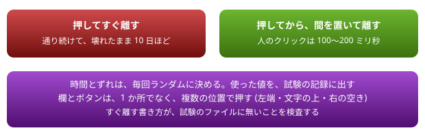
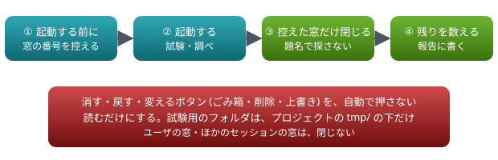
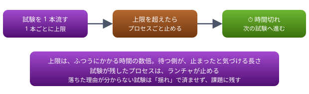
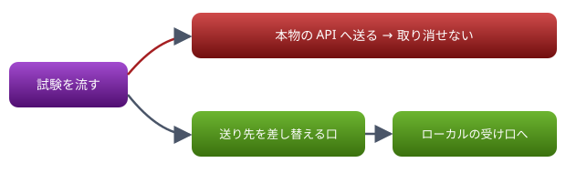

1. [1](01-はじめの一歩.md)
2. [2](02-慣れてきたら.md)
3. [3](03-文字化けとツール.md)
4. [4](04-課題と決めたことの管理.md)
5. [5](05-複数プロジェクトで使う.md)
6. [6](06-AI同士がつながる.md)
7. [7](07-並べて動かす.md)
8. [8](08-仕組みで守る.md)
9. [9](09-画面の試験と環境の事故.md)

# 09. 画面の試験と環境の事故

画面を持つ Windows アプリを作る人向けの章です。画面の試験は、人の操作に合わせます。試験で起こした窓は閉じ、時間の上限を付け、外へは送りません。クロード君の失敗から、決まりを足します

> 📅 作成: 2026-11-26 / 更新: 2026-11-27

[<<](08-仕組みで守る.md)[^^](../README.md)

1. [画面の試験は、人の操作に合わせる](#1-画面の試験は人の操作に合わせる)
2. [起こした窓は、起こした側が閉じる](#2-起こした窓は起こした側が閉じる)
3. [試験には、時間の上限を付ける](#3-試験には時間の上限を付ける)
4. [外へ送るツールの試験は、送らない口を通す](#4-外へ送るツールの試験は送らない口を通す)

## 1. 画面の試験は、人の操作に合わせる

試験は全部通ってるのに、実際に使うと、欄に入ったときの動きが壊れてた……。

画面を持つアプリは、マウスやキーを送って、試験します。このとき、人の操作とかけ離れた送り方をすると、本物の動きの不具合を見逃します。

#### 失敗の一コマ: 押してすぐ離す試験が、通り続けた

マウスを「押してすぐ離す」形で送る試験が、通り続けました。その間、**欄に入ると全体を選ぶ動きが、10 日ほど壊れたまま**でした。壊れたのは、押してから離すまでの間で、押す位置によっても結果が変わったのです。

人の操作の時間と位置に合わせる

「画面の試験は、人の操作に合わせてね」って、スキルに入れておくよ。

#### 足した決まり

- 画面の試験で、マウスやキーを送るときは、**押してから離すまでに間を置く**。人のクリックは 100〜200 ミリ秒かかり、その間に、手が数ドット動く
- 時間とずれは、毎回ランダムに決め、**使った値を試験の記録に出す** (落ちたときに、同じ押し方で再現するため)
- 押してすぐ離す書き方をしない。共通の関数にまとめ、すぐ離す書き方が、試験のファイルに無いことを検査する
- 欄とボタンは、**1 か所でなく、複数の位置で押す**。押す位置で、動きが変わる
- 数字や英数字だけを打つ欄は、IME (日本語入力) を使わない。欄を足したら、試験で、IME がオンにならないことを確かめる

出典: 共通ルール「テストのルール」(スキル `light-test`) の「試験の操作は、人の操作の時間と位置に合わせる」、「Windows のデスクトップアプリ」の「入力欄の IME」

押してから、少し間を置いて離すよ。押す場所も、いろいろ変えるね!

## 2. 起こした窓は、起こした側が閉じる

試験でエクスプローラーの窓をいくつも開いたら、閉じ忘れて、ユーザの画面に残っちゃった……。

試験や調べで、エクスプローラー・エディタ・ブラウザなど、試験の対象でないアプリの窓を起動することがあります。起動した窓は、**起動した側が必ず閉じます**。

#### 失敗の一コマ: 閉じる条件から外れた窓が残り、確認のダイアログが出た

調べが、閉じる条件 (窓の題名) から外れたエクスプローラーの窓を**5 つ残し**ました。さらに、ごみ箱の「すべての項目を元に戻す」の確認のダイアログ (**1,605 個**) を、ユーザの画面に残しました (2026-11-19)。窓は、移動すると題名が変わるため、題名で探すと、閉じ漏れになるのです。試験が起こしたエディタの窓も、残りました。

控える → 閉じる → 数える。消す・戻すボタンは、押さない

「起こした窓は、起こした側が閉じてね」って、1 枚足しておくよ。

#### 足した決まり

- 起動した窓は、起動した側が必ず閉じる。**起動する前に、窓の番号 (ハンドル) かプロセス番号を控える**。閉じるときは、控えたその窓だけを閉じる。題名で探さない
- ユーザの窓・ほかのセッションの窓は、閉じない
- **消す・戻す・変えるボタンを、自動で押さない** (ごみ箱・削除・「すべての項目を元に戻す」・ごみ箱を空にする・上書き)。読むだけにする。試験用のフォルダで足りるときは、プロジェクトの `tmp/` の下だけを使う
- どうしても押すときは、押す前に、名前の完全一致・選択数・対象を確かめ、ユーザに知らせてから押す
- 窓・メニュー・子のプロセスを出す処理を足したら、「出したまま、対象のアプリを閉じる」試験を書く
- **試験・調べの後に、起動した窓・プロセスが残っていないことを確かめ、残りを数えて報告に書く**。残っていたら、その試験を ❌ にする

出典: 共通ルール「Windows のデスクトップアプリ」の「試験・調べで他のアプリを起動する」(2026-11-19 の出来事)

起動する前に窓の番号を控えて、その窓だけ閉じるね。終わったら、残りを数えて報告するよ!

## 3. 試験には、時間の上限を付ける

15 分で終わるはずの試験が、いつまでも終わらない……。何が止まってるのか、分からないよ。

試験を一括で流すとき、1 本でも終わらない試験があると、全体が止まります。そのまま待つと、気づくのが遅れます。

#### 失敗の一コマ: 試験が残したプロセスを待ち続けて、5 時間止まった

試験が起動して**残したプロセス**を、`Start-Process -Wait` が待ち続け、15 分で終わる一括実行が、**5 時間**止まりました。`-Wait` は、子孫のプロセスの終了まで待つためです。

1 本ごとに上限を付ける。超えたら、止めて次へ

「試験には、時間の上限を付けてね」って、スキルに入れておくよ。

#### 足した決まり

- 試験を一括で流すランチャでは、**1 本ごとに時間の上限を付ける**。超えたら、試験のプロセスを子孫ごと止め、⏱️ 時間切れとして次へ進む
- 上限は、ふつうにかかる時間の数倍にする。止まったことに、待つ側が気づける長さにする
- **PowerShell の `Start-Process -Wait` を使わない**。子孫のプロセスの終了まで待つため、残ったプロセスがあると止まる。代わりに、`-PassThru` で受け、`WaitForExit(ミリ秒)` で待つ
- 試験が起動して残したプロセスは、ランチャが止める
- 落ちた理由の分からない試験も、流し直すと通った揺れも、**課題にして残す**。失敗した試験の記録は、原因を確かめるまで消さない
- 窓が要る試験は、非表示にできるものは非表示で回す (窓が開閉すると、作業中の画面とフォーカスを奪う)。ただし、窓の見え方や操作そのものを確かめる試験は除く

出典: 共通ルール「テストのルール」(スキル `light-test`) の「試験には時間の上限を付ける」「落ちた理由の分からない試験は、揺れで済ませず、課題にして残す」「窓が要る試験は、非表示で裏に回す」

1 本ごとに上限を付けて、超えたら止めて次へ進むよ。落ちた理由が分からなくても、課題に残すね!

## 4. 外へ送るツールの試験は、送らない口を通す

試験を流したら、材料が、本物のサービスへ送られちゃってた……!

外のサービスへ、本文やトークン (本人確認の合言葉) を送るツールは、試験でも、本物へ送ってしまいかねません。

#### 失敗の一コマ: 試験で、材料を本物の API へ送った

ツールの試験で、❌Red (実装の前に、書いた試験が失敗している状態) を見るために 1 回流したとき、**材料を、本物の API へ送ってしまいました**。外へ送った内容は、取り消せません。

赤い道 (本物へ送る) でなく、下の道 (ローカルの受け口) を通る

「外へ送るツールの試験は、送らない口を通してね」って、スキルに入れておくよ。

#### 足した決まり

- 外のサービスへ本文やトークンを送るツール (API・Web 取得) は、**送り先を差し替える口** (環境変数など) をツールに作る
- 試験は、**ローカルの受け口を指して**流す。差し替え先はローカルだけ許し、トークンは付けない
- 送る経路 (問題なし・異常・通信エラー) は、**経路ごとに試験で通す**。ローカルの受け口なら、通信エラーも作れる
- テストを先に書くときは、**落ちるテストを書いて、落ちるのを目で見てから**実装に入る。落ちるのを見ていないテストは、何も守っていない

出典: 共通ルール「テストのルール」(スキル `light-test`) の「外へ送るツールの試験は、送らない口を通して流す」「テストを先に書く」

試験は、ローカルの受け口へ送るよ。本物へは、送らない!

> [!TIP]
> **おわりに** ここまで 9 本、クロード君は、失敗するたびに、ルール・課題・チャット・フックの助けを借りて、うまくいくようになりました。ルールは、失敗をきっかけに足します。自分のプロジェクトでも、同じ失敗が 2 回起きたら、決まりにして、必要なら、仕組みで守らせてください。→ [01. はじめの一歩](01-はじめの一歩.md) へ戻る

[<<](08-仕組みで守る.md)[^^](../README.md)
