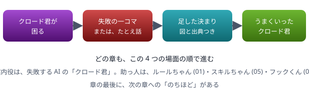
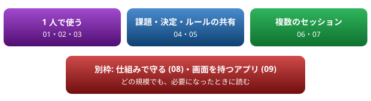
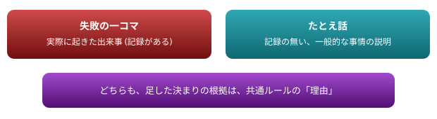
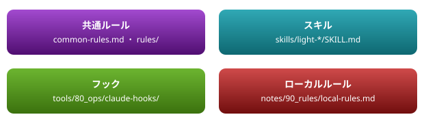

# ZZ. 構成

この勉強会の読み物 9 本の、対象読者・章立ての意図・資料の約束 (用語など)・出典の置き場をまとめた付録です。本編は順に読む資料で、この付録は、全体を見渡したいときに開きます

> 📅 作成: 2026-11-26 / 更新: 2026-11-26

[^^](../README.md)

1. [対象読者と、読み方](#1-対象読者と読み方)
2. [9 本の章立てと、意図](#2-9-本の章立てと意図)
3. [資料の約束](#3-資料の約束)
4. [出典の置き場](#4-出典の置き場)

## 1. 対象読者と、読み方

対象は、**AI エージェント (特に Claude Code) を使って開発する人**です。1 人で使い始めた人から、複数のプロジェクトと複数のセッションで使う人までを、1 本の道筋に並べました。「この資料の利用者」は、AI に頼む人 (あなた) のことです。

01〜07 は、使う規模が大きくなる順 (小 → 大) です。08 と 09 は、規模の軸ではなく、仕組みの話と、画面を持つアプリ向けの話です。まず 01 から順に読みます。自分のいまの規模に近い章から読んでも、構いません。

どの章も、失敗から決まりが生まれる形で書いてある

## 2. 9 本の章立てと、意図

各本の主役の決まりを、1 行で示します。

- [01. はじめの一歩](01-はじめの一歩.md): 1 人で使い始める。ルールが失敗から増えること、日本語で応える、フルパスを出さない、commit は指示を待つ
- [02. 慣れてきたら](02-慣れてきたら.md): 実行の合図は決まった言葉だけ、失敗したら直し方を決めずに報告する、確かめてから言い切る、仕様も疑う、短い作業は見張る
- [03. 文字化けと道具](03-文字化けと道具.md): 文字コードと改行を「組」で扱う道具 (`text`・`convert-encoding`・`psh`)、ブロックを回避しない
- [04. 課題と決めたことの管理](04-課題と決めたことの管理.md): 課題は 1 件 1 ファイル、決めることは番号付きの選択肢 (A・B・C)、計画と承認が先、書いた資料はレビューを通す
- [05. 複数プロジェクトで使う](05-複数プロジェクトで使う.md): ルールを核とスキルに分ける、他プロジェクトは直さない、公開前に確かめる、画面を使う作業は 1 つずつ
- [06. AI 同士がつながる](06-AI同士がつながる.md): チャットの待受けを数える・止める・読み切る、周知は短く
- [07. 並べて動かす](07-並べて動かす.md): レビュー専用のセッション (サブエージェント)、状態の色、引継ぎ、セッション間の指示
- [08. 仕組みで守る](08-仕組みで守る.md): フックで止める (英語の混入・失敗した編集の後の commit)、フックの場面と変え方
- [09. 画面の試験と環境の事故](09-画面の試験と環境の事故.md): 画面の試験は人の操作に合わせる、起こした窓は閉じる、時間の上限、外へ送らない口

01〜07 は、規模が大きくなる順。08・09 は、別枠

## 3. 資料の約束

- **「失敗の一コマ」と「たとえ話」**。実際に起きた出来事 (記録がある) は、「失敗の一コマ」です。記録の無い一般的な事情の説明は、「たとえ話」です。吹き出しも、記録の無い話は、可能性の形で書いてあります
- **「セッション (サブエージェント)」と「メインの AI」**。「セッション (サブエージェント)」は、メインの AI が呼んで作業させる別の AI です。「メインの AI」は、それを呼ぶ側です。「別のセッション」は、メインとは別に動く、独立したセッションを指します
- **「背景 (バックグラウンド処理)」**。処理の「背景」は、この形で書きます。「利用者」は、AI に頼む人です
- <strong>「このプロジェクトだけの決め」</strong>は、「ローカルルール」と明記してあります。共通ルールの決まりとは、区別してください
- **他のプロジェクトの名前**は文中に書きますが、リンクは貼りません

出来事に記録があるかで、2 つを分ける

## 4. 出典の置き場

各章の「出典」には、共通ルールの章の名前を書いてあります。共通ルールの実体は、このプロジェクト (`ai-agent-rules`) の、次の 4 か所にあります。ほかに、別のプロジェクトが 2 つあります。

- **共通ルールの本体と章**: `common-rules.md` と `rules/` (毎回読む部分)
- **状況別の章 (スキル)**: `skills/light-*/SKILL.md`。出典に「スキル `light-xxx`」とあるものは、ここ
- **フック**: `tools/80_ops/claude-hooks/` (README に、各フックの役目の表がある)
- **ローカルルール**: `notes/90_rules/local-rules.md` (このプロジェクトだけの決め。章の切り出しルール・フックの置き場とメンテなど)
- **別のプロジェクト (2 つ)**: 共有 CLI (`ai-agent-tools`) と、AI 間チャット (`ai-chat-lite`) は、別のプロジェクト。使い方は、それぞれの資料を見る

出典の置き場は、このプロジェクトの 4 か所

#### 各本の出典

- 01: 共通ルール「ワークフロールール」「言語表記」「セキュリティルール」
- 02: 「確認と失敗」「ワークフロールール」「シェル実行ルール」
- 03: 「コーディングルール」「シェル実行ルール」
- 04: 「ワークフロールール」(課題の管理・複数の解決案・機能の追加と変更の順序・レビュー)
- 05: 「セキュリティルール」「確認と失敗」、ローカルルール、スキル `light-test`
- 06: 「共有環境の使い方」(スキル `light-shared-env`)、「記録と運用」
- 07: 「ワークフロールール」「記録と運用」「共有環境の使い方」
- 08: 「言語表記」「記録と運用」「ワークフロールール」、フックの README (`README.html`)、ローカルルール
- 09: 「Windows のデスクトップアプリ」、スキル `light-test`

[^^](../README.md)
